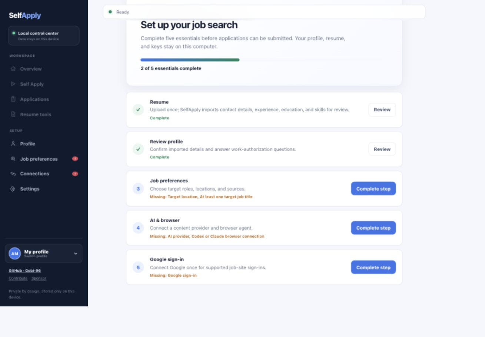
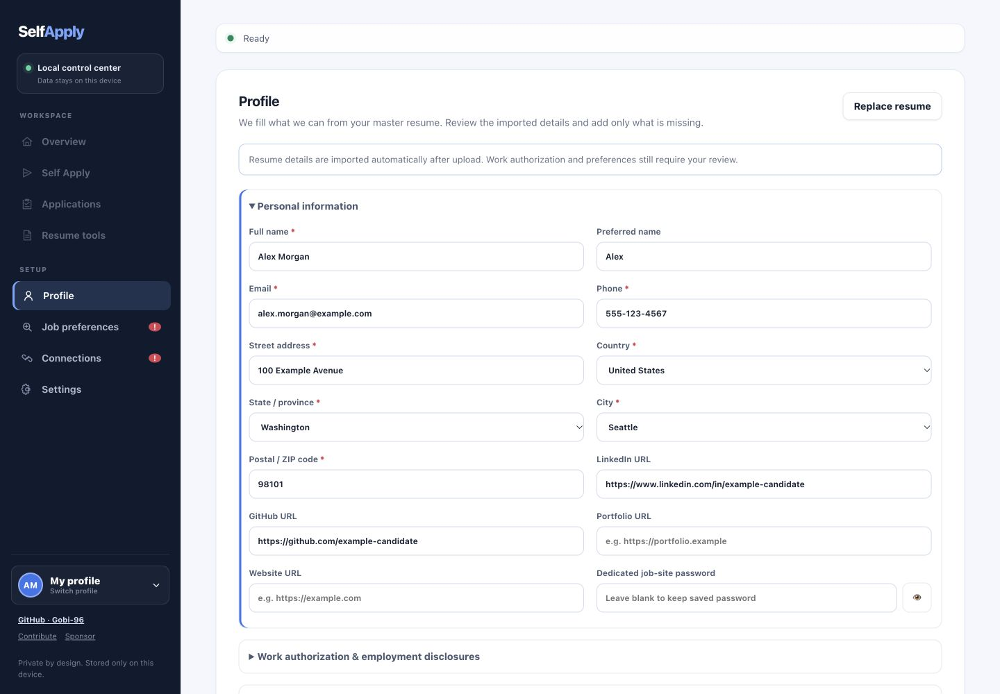

> **SelfApply** is an open-source application. See
> [THIRD_PARTY_NOTICES.md](THIRD_PARTY_NOTICES.md) for license disclosures.

# SelfApply

**A local, UI-first job discovery, resume tailoring, and application assistant.**

SelfApply keeps candidate profiles, resumes, job history, browser sessions, and
API credentials on the user's computer. It does not install a login item or
start an application worker automatically; work begins only when the user
starts it from the Control Center or CLI.



## Highlights

- Guided local setup with readiness checks before applications can run
- Up to five isolated candidate profiles on one computer
- Job discovery across major boards, Workday portals, and direct career sites
- AI fit scoring, factual resume tailoring, and cover-letter generation
- DOCX/PDF resume preservation with change reports and validation
- Guarded browser automation through Codex, including a no-submit dry-run mode
- Application history, retry controls, worker limits, and spending caps
- Local backup and reset tools for profiles, documents, logs, and sessions

## Before you use it

1. Create your profile in the Control Center; do not add personal data or API
   keys to files inside this repository.
2. Start with `selfapply apply --dry-run` and inspect the filled form before
   enabling submission.
3. Review every tailored resume and answer. The user remains responsible for
   the accuracy of submitted information.
4. Use a dedicated job-site password rather than a password reused elsewhere.
5. Respect job-board terms, rate limits, and local law. SelfApply does not
   bypass CAPTCHAs, forced logins, expired listings, or blocked sites.

## Quick start (UI-first, recommended)

This project supports Codex as the default browser agent while preserving the
existing discovery, scoring,
tailoring, cover-letter, PDF, database, Chrome, and application prompt flow.

The Control Center is the UI-first setup path. On first launch, its onboarding
checklist guides a new user through **Profile**, **Job preferences**,
**Resume**, and **AI & browser** before the application workspace unlocks.
Recognizable OpenAI, Anthropic, and Gemini API-key prefixes select the provider;
the real connection test verifies the saved provider and model. The UI starts
and stops the guarded worker. No other terminal setup command is required.

### Sample profile

The repository's [`profile.example.json`](profile.example.json) contains only
fictional placeholders. The screenshot below was captured from an isolated
temporary SelfApply home using fictional data; it contains no developer or
candidate account information.



```bash
git clone https://github.com/Gobi-96/SelfApply.git
cd SelfApply
python3 -m venv .venv
source .venv/bin/activate
python -m pip install --upgrade pip
python -m pip install -e .
python -m pip install --no-deps python-jobspy
python -m pip install pydantic tls-client requests markdownify regex
playwright install chromium

selfapply ui
```

Prefer a source archive instead of Git? Download the
[latest `main` ZIP](https://github.com/Gobi-96/SelfApply/archive/refs/heads/main.zip),
extract it, and run the same setup commands from the extracted folder.

All candidate data stays in `~/.selfapply`. **Settings → Back up and reset local
data** stops the worker, moves the current profile, application history,
resumes, logs, sessions, and secrets into a private timestamped local backup,
then returns the app to first-run onboarding.

Windows PowerShell activation is `.\.venv\Scripts\Activate.ps1`; Windows
Command Prompt uses `.venv\Scripts\activate.bat`. Then run the same `pip`,
`playwright`, and `selfapply ui` commands. The Control Center starts and stops
its background worker directly on Windows and Linux, with the same UI controls
used on macOS.

In existing-browser mode, the extension assigns the selected tab to a dedicated
tab group and Codex reuses that tab instead of launching another Chrome. The
Codex adapter retries transient failures through
SelfApply's existing retry counter, rejects non-job/talent-network forms, and
stops an individual job after its configured action/time limits. Gmail is
enabled only when `~/.gmail-mcp/gcp-oauth.keys.json` exists, and Codex is limited
to `search_emails` and `read_email`; sending or modifying email is not enabled.
CAPTCHAs, forced login, expired listings, and blocked sites still require manual
handling and are not bypassed.

[](https://www.python.org/downloads/)
[](LICENSE)
[](https://github.com/Gobi-96/SelfApply)
---

## What It Does

SelfApply is a 6-stage autonomous job application pipeline. It discovers jobs across 5+ boards, scores them against your resume with AI, tailors your resume per job, writes cover letters, and **submits applications for you**. It navigates forms, uploads documents, answers screening questions, all hands-free.

The commands below are the terminal alternative to the recommended Control
Center—not a second required setup path.

```bash
git clone https://github.com/Gobi-96/SelfApply.git
cd SelfApply
python3 -m venv .venv
source .venv/bin/activate
pip install -e .
pip install --no-deps python-jobspy && pip install pydantic tls-client requests markdownify regex
playwright install chromium
selfapply init          # one-time setup: resume, profile, preferences, API keys
selfapply doctor        # verify your setup — shows what's installed and what's missing
selfapply run           # discover > enrich > score > tailor > cover letters
selfapply run -w 4      # same but parallel (4 threads for discovery/enrichment)
selfapply apply         # autonomous browser-driven submission
selfapply apply -w 3    # parallel apply (3 Chrome instances)
selfapply apply --dry-run  # fill forms without submitting
```

> **Why two install commands?** `python-jobspy` pins an exact numpy version in its metadata that conflicts with pip's resolver, but works fine at runtime with any modern numpy. The `--no-deps` flag bypasses the resolver; the second command installs jobspy's actual runtime dependencies. Everything except `python-jobspy` installs normally.

---

## Two Paths

### Full Pipeline (recommended)
**Requires:** Python 3.11+, Node.js (for npx), a supported AI provider, Codex CLI, and Chrome. Claude Code is an optional browser-agent fallback.

Runs all 6 stages, from job discovery to autonomous application submission. This is the full power of SelfApply.

### Discovery + Tailoring Only
**Requires:** Python 3.11+, Gemini API key (free)

Runs stages 1-5: discovers jobs, scores them, tailors your resume, generates cover letters. You submit applications manually with the AI-prepared materials.

---

## The Pipeline

| Stage | What Happens |
|-------|-------------|
| **1. Discover** | Scrapes 5 job boards (Indeed, LinkedIn, Glassdoor, ZipRecruiter, Google Jobs) + 48 Workday employer portals + 30 direct career sites |
| **2. Enrich** | Fetches full job descriptions via JSON-LD, CSS selectors, or AI-powered extraction |
| **3. Score** | AI rates every job 1-10 based on your resume and preferences. Only high-fit jobs proceed |
| **4. Tailor** | AI applies targeted JD-aware edits inside a clone of your master resume while preserving its structure, links, employers, titles, and dates |
| **5. Cover Letter** | AI generates a targeted cover letter per job |
| **6. Auto-Apply** | Codex (or optional Claude fallback) navigates application forms, fills fields, uploads documents, answers questions, and submits |

Each stage is independent. Run them all or pick what you need.

---

## SelfApply vs The Alternatives

| Feature | SelfApply | AIHawk | Manual |
|---------|-----------|--------|--------|
| Job discovery | 5 boards + Workday + direct sites | LinkedIn only | One board at a time |
| AI scoring | 1-10 fit score per job | Basic filtering | Your gut feeling |
| Resume tailoring | Per-job AI rewrite | Template-based | Hours per application |
| Auto-apply | Full form navigation + submission | LinkedIn Easy Apply only | Click, type, repeat |
| Supported sites | Indeed, LinkedIn, Glassdoor, ZipRecruiter, Google Jobs, 46 Workday portals, 28 direct sites | LinkedIn | Whatever you open |
| License | AGPL-3.0 | MIT | N/A |

---

## Requirements

| Component | Required For | Details |
|-----------|-------------|---------|
| Python 3.11+ | Everything | Core runtime |
| Node.js 18+ | Auto-apply | Needed for `npx` to run Playwright MCP server |
| Gemini API key | Scoring, tailoring, cover letters | Free tier (15 RPM / 1M tokens/day) is enough |
| Chrome/Chromium | Auto-apply | Auto-detected on most systems |
| Codex CLI | Auto-apply (default) | Install from [github.com/openai/codex](https://github.com/openai/codex) |
| Claude Code CLI | Optional fallback | Install from [claude.ai/code](https://claude.ai/code) |

**Gemini API key is free.** Get one at [aistudio.google.com](https://aistudio.google.com). OpenAI and local models (Ollama/llama.cpp) are also supported.

### Optional

| Component | What It Does |
|-----------|-------------|
| CapSolver API key | Optional third-party CAPTCHA integration. Without it, CAPTCHA-blocked applications stop for manual handling |

> **Note:** python-jobspy is installed separately with `--no-deps` because it pins an exact numpy version in its metadata that conflicts with pip's resolver. It works fine with modern numpy at runtime.

---

## Configuration

All generated by `selfapply init`:

### `profile.json`
Your personal data in one structured file: contact info, work authorization, compensation, experience, skills, resume facts (preserved during tailoring), and EEO defaults. Powers scoring, tailoring, and form auto-fill.

Runtime profiles are stored below `~/.selfapply/profiles/` and are ignored by
Git. Enter passwords and API keys through the local UI; never put real secrets
in `profile.example.json`, `.env.example`, screenshots, issues, or commits.

### `searches.yaml`
Job search queries, target titles, locations, boards. Run multiple searches with different parameters.

### `.env`
API keys and runtime config: `GEMINI_API_KEY`, `LLM_MODEL`, `CAPSOLVER_API_KEY` (optional).

### Package configs (shipped with SelfApply)
- `config/employers.yaml` - Workday employer registry (48 preconfigured)
- `config/sites.yaml` - Direct career sites (30+), blocked sites, base URLs, manual ATS domains
- `config/searches.example.yaml` - Example search configuration

---

## How Stages Work

### Discover
Queries Indeed, LinkedIn, Glassdoor, ZipRecruiter, Google Jobs via JobSpy. Scrapes 48 Workday employer portals (configurable in `employers.yaml`). Hits 30 direct career sites with custom extractors. Deduplicates by URL.

### Enrich
Visits each job URL and extracts the full description. 3-tier cascade: JSON-LD structured data, then CSS selector patterns, then AI-powered extraction for unknown layouts.

### Score
AI scores every job 1-10 against your profile. 9-10 = strong match, 7-8 = good, 5-6 = moderate, 1-4 = skip. Only jobs above your threshold proceed to tailoring.

### Tailor
Generates a custom resume per job using anchored edits rather than rebuilding the whole document. DOCX uploads retain their styles, spacing, tables, columns, links, headers, footers, employer names, titles, and dates; PDF uploads use best-effort in-place editing with a visible fidelity warning when reconstruction is required. Each job stores its TXT extraction, patch manifest, report, source-format document, and verified application PDF. If creative skill expansion is enabled, unsupported additions are warnings rather than blockers and should be reviewed before use.

### Cover Letter
Writes a targeted cover letter per job referencing the specific company, role, and how your experience maps to their requirements.

### Auto-Apply
The selected browser agent launches or connects to Chrome, navigates to each application page, detects the form type, fills personal information and work history, uploads the tailored resume and cover letter, answers screening questions with AI, and submits. A live dashboard shows progress in real time.

The Playwright MCP server is configured automatically at runtime per worker. No manual MCP setup needed.

```bash
# Utility modes (no browser agent needed)
selfapply apply --mark-applied URL    # manually mark a job as applied
selfapply apply --mark-failed URL     # manually mark a job as failed
selfapply apply --reset-failed        # reset all failed jobs for retry
selfapply apply --gen --url URL       # generate prompt file for manual debugging
```

---

## CLI Reference

```
selfapply init                         # First-time setup wizard
selfapply doctor                       # Verify setup, diagnose missing requirements
selfapply run [stages...]              # Run pipeline stages (or 'all')
selfapply run --workers 4              # Parallel discovery/enrichment
selfapply run --stream                 # Concurrent stages (streaming mode)
selfapply run --min-score 8            # Override score threshold
selfapply run --dry-run                # Preview without executing
selfapply run --validation lenient     # Relax validation (recommended for Gemini free tier)
selfapply run --validation strict      # Strictest validation (retries on any banned word)
selfapply apply                        # Launch auto-apply
selfapply apply --workers 3            # Parallel browser workers
selfapply apply --dry-run              # Fill forms without submitting
selfapply apply --continuous           # Run forever, polling for new jobs
selfapply run-worker --max-spend 25     # Replenish and apply continuously; stops at $25 spent
selfapply run-worker --max-spend 25 --target-applied 500 --queue-threshold 50
# --max-spend is required: continuous unattended applying must not launch without a budget cap.
selfapply apply --headless             # Headless browser mode
selfapply apply --url URL              # Apply to a specific job
selfapply status                       # Pipeline statistics
selfapply report                       # Open the static HTML results report
# The live worker dashboard appears automatically during apply/run-worker.
# `selfapply dashboard` remains a compatibility alias for `report`.
```

---

## Contributing

Contributions are welcome. Start with the
[contribution guide](CONTRIBUTING.md), then open an
[issue](https://github.com/Gobi-96/SelfApply/issues) or submit a
[pull request](https://github.com/Gobi-96/SelfApply/pulls).

The source repository is available at
[github.com/Gobi-96/SelfApply](https://github.com/Gobi-96/SelfApply).

If SelfApply is useful to you, you can support continued development through
[GitHub Sponsors](https://github.com/sponsors/Gobi-96).

---

## License

SelfApply is licensed under the [GNU Affero General Public License v3.0](LICENSE).

You are free to use, modify, and distribute this software. If you deploy a modified version as a service, you must release your source code under the same license.
